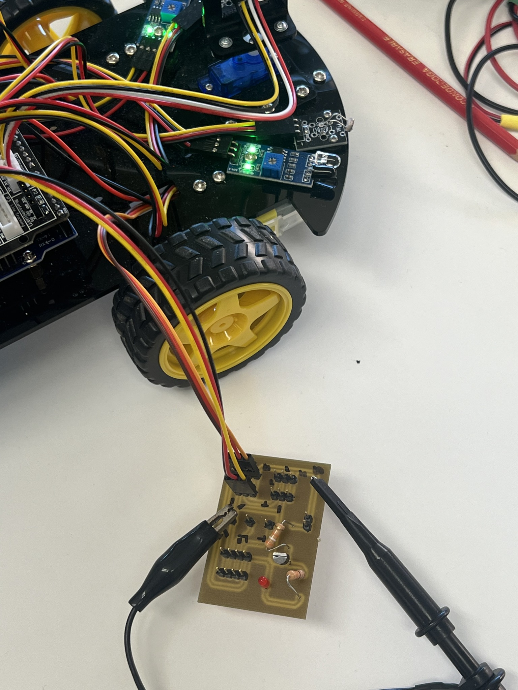
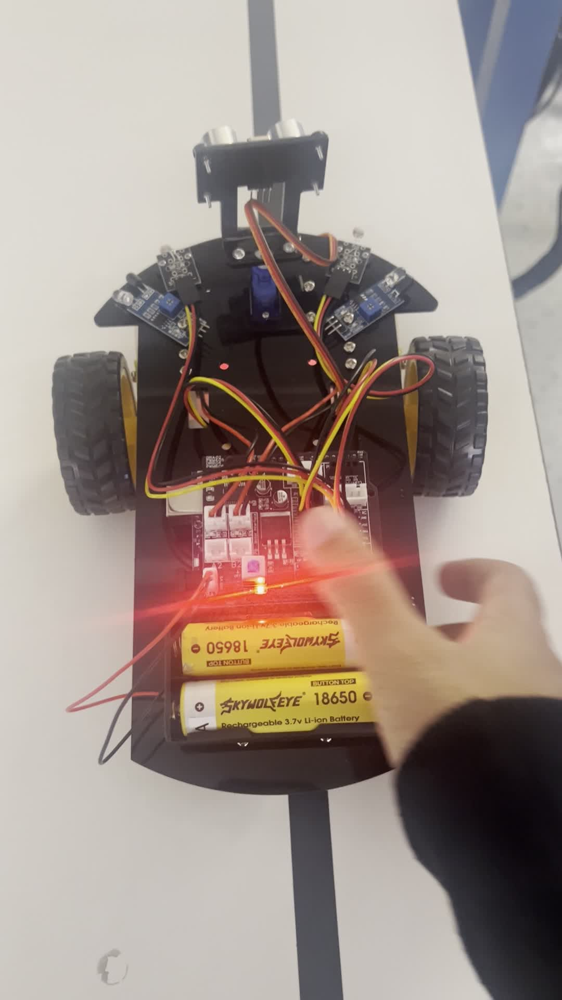
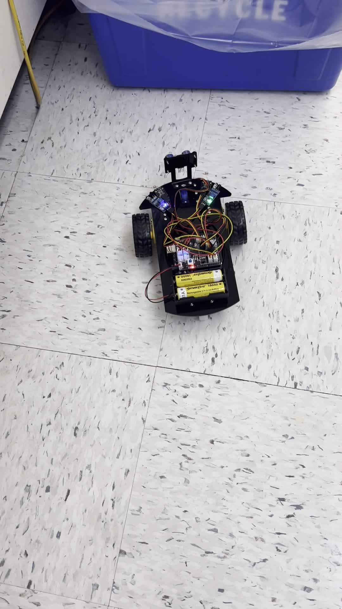
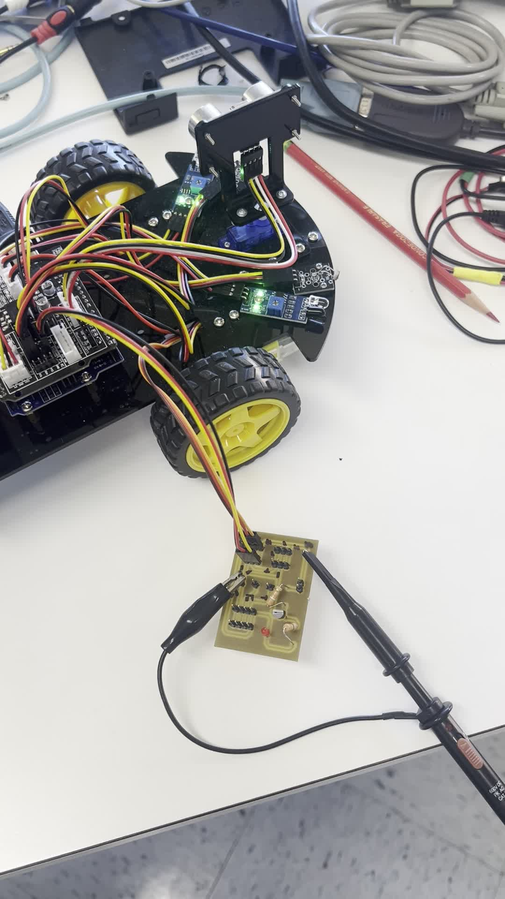

# Arduino Autonomous Robot Car

**Embedded Systems | Robotics | Sensor Integration | Motor Control**



## Overview

I built and programmed a two-wheel Arduino-based robot car that can execute programmed movements, detect and avoid obstacles, and follow a line using sensors mounted underneath the chassis. The project combined mechanical assembly, soldering a sensor-related circuit board, wiring, embedded programming, and hands-on testing to make the robot respond to its environment.

This repository documents the hardware build, Arduino IDE programming evidence, and video demonstrations of the project.

## Key Features

- **Programmed movement:** Controlled the robot's movement and turning through Arduino code.
- **Obstacle detection and avoidance:** Used a forward-facing sensor setup to detect obstacles and respond by changing movement.
- **Line following:** Used bottom-mounted sensors to detect a path and guide the robot along it.
- **Custom soldered circuit:** Soldered components and connections on a brown circuit board used with the robot’s sensor system.
- **Hardware/software integration:** Connected motors, sensors, and control electronics, then tested their behavior together.

## Hardware and Software

The project uses the following components, based on the build and documentation:

- Arduino Uno microcontroller
- Two-wheel robot chassis, wheels, and DC motors
- Motor driver electronics
- Forward-facing ultrasonic distance sensor
- Bottom-mounted infrared line-tracking sensors
- Servo motor and additional sensor modules visible in the assembly
- Hand-soldered sensor-related circuit board (pictured below)
- Jumper wires and power connections
- Arduino IDE and Arduino C/C++

*Exact module models, pin assignments, and power specifications should be added after checking the original build or source files.*

## How It Works

### 1. Programmed movement

The Arduino runs movement routines to drive the motors and control the robot's direction. These routines were used to test basic movement and turning.

### 2. Obstacle avoidance

The robot uses its front sensor setup to detect objects in its path. Its control logic responds to obstacles by changing the robot's movement to avoid a collision.

### 3. Line following

Sensors mounted below the robot detect the line/path on the ground. The Arduino uses the sensor readings to adjust the motors and follow the path.

## Soldered Sensor Circuit

As part of the hardware build, I soldered the components and connections on the brown circuit board shown in the project photo. The board worked with the robot’s sensor setup, giving me hands-on experience with circuit assembly, physical electrical connections, and hardware testing.


*The exact circuit function and component values can be documented in more detail once the original schematic is available.*

## Project Gallery

### Robot assembly


### Demonstration video frames

| Clip | Preview | Video |
| --- | --- | --- |
| Recording 1 |  | [Watch recording 1](videos/IMG_1229.mp4) |
| Recording 2 |  | [Watch recording 2](videos/IMG_1257.mp4) |
| Recording 3 |  | [Watch recording 3](videos/IMG_1289.mp4) |

*The recordings retain their original filenames because their exact feature-by-feature labels have not been independently verified.*

### Arduino IDE screenshots

These screenshots document portions of the Arduino programs and testing process. They are **not** complete, runnable source code.

.png)
.png)
.png)
.png)
.png)

## Engineering Skills Demonstrated

- Arduino microcontroller programming with C/C++
- DC motor control and movement sequencing
- Sensor integration and input-driven control
- Hand soldering, circuit board assembly, and electrical connections
- Circuit wiring and electromechanical assembly
- Hardware troubleshooting and functional testing
- Embedded hardware/software integration

## Repository Structure

```text
arduino-autonomous-robot-car/
├── README.md
├── code/
│   └── README.md
├── images/
│   ├── robot-hardware.jpg
│   ├── IMG_1229.jpg
│   ├── IMG_1257.jpg
│   ├── IMG_1289.jpg
│   └── image(...).png (Arduino IDE screenshots)
└── videos/
    ├── IMG_1229.mp4
    ├── IMG_1257.mp4
    └── IMG_1289.mp4
```

## Future Documentation Improvements

- Upload the original `.ino` files for each robot behavior.
- Add a wiring diagram and the Arduino pin assignments.
- Identify the exact motor driver and sensor module models.
- Label each video with the specific behavior demonstrated.

## Project Summary

This project gave me practical experience building an embedded robotic system from hardware assembly through programming and functional testing. I soldered a sensor-related circuit board and integrated motors and sensors with an Arduino controller to implement programmed movement, obstacle avoidance, and line following.
